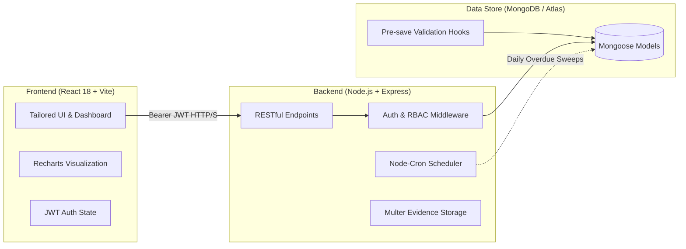

<div align="center">

# 🌿 AuditFlow
### **Industrial Environmental Audits, Automated CAPA & Statutory Reporting**

<p align="center">
  <b>Audit it. Fix it. Report it.</b><br>
  <i>One unified platform where non-compliances auto-raise corrective actions, effluent & stack readings are tested against statutory limits, and regulatory returns build themselves.</i>
</p>

<p align="center">
  <a href="https://auditflow-pi-two.vercel.app"></a>
  <a href="https://github.com/monisx1206/auditflow"></a>
  
  
</p>

<p align="center">
  
  
  
  
  
  
  
</p>

---

</div>

## 📑 Table of Contents
- [✨ Key Highlights](#-key-highlights)
- [🏗 System Architecture](#-system-architecture)
- [⚡ What Makes It More Than CRUD](#-what-makes-it-more-than-crud)
- [👥 Role-Based Access Control](#-role-based-access-control)
- [🔐 Pre-Seeded Demo Accounts](#-pre-seeded-demo-accounts)
- [🚀 Quick Start (Local Setup)](#-quick-start-local-setup)
- [🌐 Cloud Deployment (Vercel + Render + Atlas)](#-cloud-deployment)
- [📡 API Reference](#-api-reference)
- [📁 Project Structure](#-project-structure)
- [🛡 Security & Compliance](#-security--compliance)

---

## ✨ Key Highlights

<table>
  <tr>
    <td width="50%">
      <h3>🔍 Smart Auditing & Auto-Scoring</h3>
      <ul>
        <li>Dynamic checklists categorized by EHS focus areas (Water, Air, Haz-waste, Noise).</li>
        <li>Completing an audit auto-locks records, computes compliance index (%), and <b>auto-raises CAPAs</b> for every non-compliance found.</li>
      </ul>
    </td>
    <td width="50%">
      <h3>🧪 Limit Exceedance Detection</h3>
      <ul>
        <li>Pre-save hooks validate environmental readings (BOD, COD, PM2.5, pH) against consent thresholds.</li>
        <li>Instant violation alerts with automated escalation to the facility manager.</li>
      </ul>
    </td>
  </tr>
  <tr>
    <td width="50%">
      <h3>🔄 4-Stage CAPA Lifecycle</h3>
      <ul>
        <li>Workflow: <code>Open</code> ➔ <code>In Progress</code> ➔ <code>Pending Verification</code> ➔ <code>Closed</code>.</li>
        <li>Audit trails with root-cause analysis, proof/evidence uploads via Multer, and auditor sign-off.</li>
      </ul>
    </td>
    <td width="50%">
      <h3>📊 Regulatory Returns & Statutory Filing</h3>
      <ul>
        <li>One-click compilation of environmental compliance returns (TNPCB, CPCB, EPA).</li>
        <li>Auto-aggregates inspections, violations, and corrective measures with <b>CSV export</b>.</li>
      </ul>
    </td>
  </tr>
</table>

---

## 🏗 System Architecture



---

## ⚡ What Makes It More Than CRUD

| Capability | Technical Implementation | Impact |
|:---|:---|:---|
| **Auto-Raised CAPA** | `auditController.complete` | Eliminates manual finding transfer; creates time-bound corrective actions (7 / 30 / 60 days based on severity). |
| **Real-time Limit Guard** | `Inspection` Schema pre-save hook | Catches discharge exceedances immediately upon entry; prevents regulatory penalties. |
| **Separation of Duties** | `capaController.update` | Site Managers can submit root-cause & evidence, but **only Auditors/Admins** can verify and close actions. |
| **Automated SLA Enforcer** | `utils/scheduler.js` (cron) | Nightly automated sweeps transition overdue CAPAs and trigger dashboard deadline ribbons. |
| **Dynamic Statutory Return** | `reportController.generate` | Aggregates all live audit findings, emission tests, and closed CAPAs into regulatory format with 1 click. |
| **60-Day Timeline Ribbon** | `pages/Dashboard.jsx` | Consolidated Gantt-style timeline plotting consent renewals, audit deadlines, and inspection dates. |

---

## 👥 Role-Based Access Control

```
                 ┌───────────────────────────────────────────────┐
                 │                 👑 Admin                      │
                 │   Site Configs • User Management • Overrides  │
                 └───────────────────────┬───────────────────────┘
                                         │
                 ┌───────────────────────┴───────────────────────┐
                 ▼                                               ▼
   ┌───────────────────────────┐                   ┌───────────────────────────┐
   │       📋 Auditor          │                   │     🏭 Site Manager       │
   │ • Schedule/Complete Audits│                   │ • View Assigned Site Ops  │
   │ • Log Environmental Tests │                   │ • Document Root Causes    │
   │ • Verify & Close CAPAs    │                   │ • Upload Action Evidence  │
   │ • Generate Board Reports  │                   │ • (Cannot self-close CAPA)│
   └───────────────────────────┘                   └───────────────────────────┘
```

---

## 🔐 Pre-Seeded Demo Accounts

The project comes pre-loaded with industrial cluster demo data (Tamil Nadu SIPCOT dyeing, automotive, and petrochemical facilities):

| Role | Badge | Email | Password | Primary Scope |
|:---|:---:|:---|:---|:---|
| **Admin** | `🔴 System Admin` | `admin@auditflow.io` | `admin123` | Full enterprise control, site & team provisioning |
| **Auditor** | `🔵 Lead Auditor` | `auditor@auditflow.io` | `audit123` | Audits, inspection testing, verification & closing |
| **Site Manager** | `🟢 Facility Lead` | `manager@auditflow.io` | `manager123` | CAPA remediation, root-cause entry, evidence files |

---

## 🚀 Quick Start (Local Setup)

### Prerequisites
- [Node.js 18+](https://nodejs.org/)
- [MongoDB](https://www.mongodb.com/) (Local service or MongoDB Atlas cluster)

### 1️⃣ Clone & Navigate
```bash
git clone https://github.com/monisx1206/auditflow.git
cd auditflow
```

### 2️⃣ Backend Setup
```bash
cd backend
cp .env.example .env

# Configure your environment in .env
PORT=5000
MONGO_URI=mongodb://127.0.0.1:27017/auditflow
JWT_SECRET=your_jwt_secret_key_here
CLIENT_ORIGIN=http://localhost:5173

# Install, seed demo data & start
npm install
npm run seed
npm run dev
```
> *API server runs at `http://localhost:5000`*

### 3️⃣ Frontend Setup
*(In a separate terminal)*
```bash
cd frontend
npm install
npm run dev
```
> *UI runs at `http://localhost:5173`*

---

## 🌐 Cloud Deployment

<details>
<summary><b>Click to expand Vercel & Render deployment guide</b></summary>

### 1. Database (MongoDB Atlas)
1. Create a free **M0 Cluster** at [MongoDB Atlas](https://www.mongodb.com/cloud/atlas).
2. Under **Network Access**, allow access from anywhere (`0.0.0.0/0`).
3. Under **Database Access**, create a user and copy the connection string.

### 2. Backend (Render / Railway)
1. Connect `monisx1206/auditflow` to [Render](https://render.com).
2. Set Root Directory to `backend`.
3. Add environment variables:
   - `MONGO_URI`: `mongodb+srv://<user>:<pwd>@cluster.mongodb.net/auditflow?retryWrites=true&w=majority`
   - `JWT_SECRET`: `your_secure_secret`
   - `CLIENT_ORIGIN`: `https://your-frontend.vercel.app`
4. The server automatically seeds the database on initial cloud boot!

### 3. Frontend (Vercel)
1. Import repository `monisx1206/auditflow` on [Vercel](https://vercel.com).
2. Select Root Directory as `frontend`.
3. Set Environment Variable: `VITE_API_URL=https://your-backend.onrender.com/api`.
4. Deploy!
</details>

---

## 📡 API Reference

All requests expect `Authorization: Bearer <token>` header, except for `/auth/login`.

| Method | Endpoint | Description | Role Required |
|:---:|:---|:---|:---:|
| `POST` | `/api/auth/login` | Authenticate user & receive JWT token | Public |
| `GET` | `/api/auth/me` | Fetch active user profile | Any |
| `GET` | `/api/dashboard` | Aggregated metrics, scores, & upcoming 60-day ribbon | Any |
| `GET` | `/api/sites` | List all industrial facilities & consent statuses | Any |
| `POST` | `/api/sites` | Register a new facility | Admin |
| `GET` | `/api/audits` | Query compliance audits | Any |
| `PUT` | `/api/audits/:id/checklist` | Update section compliance items | Auditor, Admin |
| `POST` | `/api/audits/:id/complete` | Finalize audit, score, and **auto-raise CAPAs** | Auditor, Admin |
| `GET` | `/api/inspections` | Fetch environmental monitoring logs | Any |
| `POST` | `/api/inspections` | Record readings (auto-flags limit exceedances) | Auditor, Admin |
| `GET` | `/api/capas` | Query CAPAs with severity & SLA filters | Any |
| `PUT` | `/api/capas/:id` | Update remediation plan or close CAPA | Assigned / Auditor |
| `POST` | `/api/capas/:id/evidence` | Upload photographic or document evidence | Assigned / Auditor |
| `POST` | `/api/reports/:id/generate` | Build statutory return from period data | Auditor, Admin |
| `GET` | `/api/reports/export/csv` | Download official statutory return in CSV | Auditor, Admin |

---

## 📁 Project Structure

```bash
auditflow/
├── backend/
│   ├── config/          # MongoDB connection with connection caching
│   ├── controllers/     # Business logic (Audit scoring, CAPA state, Reports)
│   ├── middleware/      # JWT verification, RBAC guards, Error handlers
│   ├── models/          # Mongoose schemas (Site, Audit, Inspection, Capa, Report)
│   ├── routes/          # Express route definitions
│   ├── uploads/         # Evidence file storage
│   ├── utils/           # Cron scheduler & comprehensive industrial seed script
│   └── server.js        # Server entry point
│
├── frontend/
│   ├── src/
│   │   ├── components/  # Layout, navigation bar, timeline ribbon
│   │   ├── pages/       # Dashboard, Audits, CAPAs, Inspections, Reports, Sites
│   │   ├── api.js       # Axios client with interceptors
│   │   ├── ui.jsx       # Custom badge, card, and modal components
│   │   └── styles.css   # Clean, modern enterprise design system
│   ├── index.html       # Single-page HTML5 shell
│   └── vite.config.js   # Vite configuration with local proxy
│
└── database/
    └── SCHEMA.md        # Full database dictionary, indexes, & relations
```

---

## 🛡 Security & Compliance

- **Authentication:** Stateless JSON Web Tokens (JWT) with configurable TTL.
- **Password Security:** Salted `bcryptjs` hashing.
- **HTTP Protection:** `helmet` headers, cross-origin resource protection, CORS allowlisting.
- **Audit Trails:** Immutable history array logging `action`, `by`, `date`, and `comment` for every CAPA state change.
- **Input Sanitization:** Mongoose validation constraints on all numerical readings and statutory thresholds.

---

<div align="center">
  <sub>Built with ❤️ for industrial environmental protection and statutory compliance.</sub>
</div>
